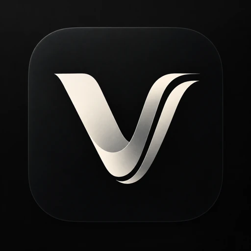
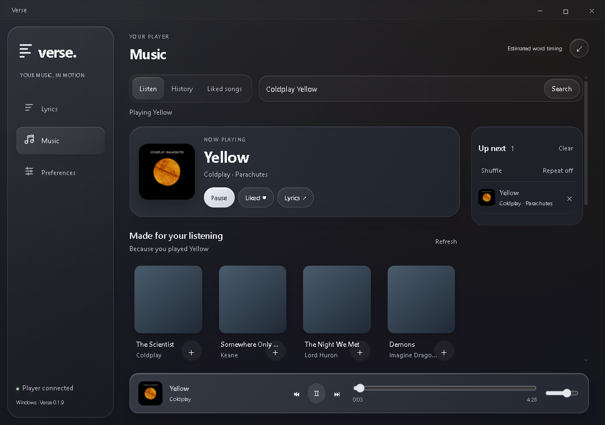
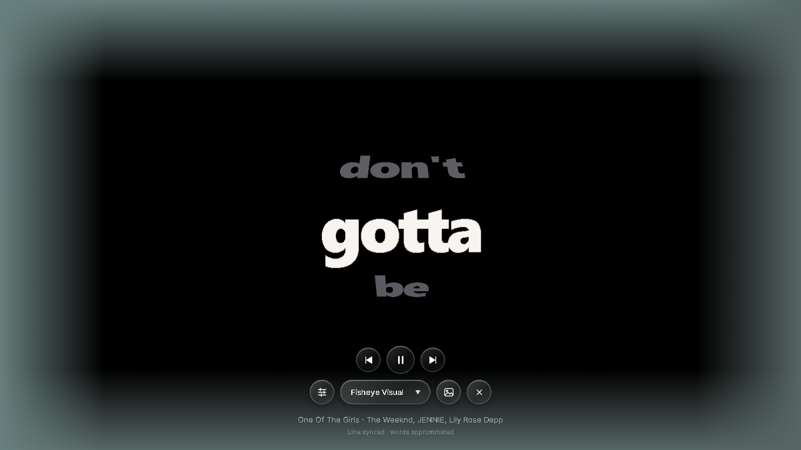

<div align="center">



# Verse

### Your music. In motion.

A Windows music player and animated lyrics companion.


[Local preview](#local-preview) · [Public source features](#made-for-listening) · [Run locally](#run-locally) · [Build](#build-for-windows)

</div>

**Big words. Quiet controls. Your music, centre stage.**

Verse combines music playback, word-by-word lyric animation, a transparent desktop overlay, and an immersive fullscreen view. It is an independent project inspired by Verci, built for Windows.

> **Source-only repository.** No EXE, installer, packaged build, dependency folder, local profile, cache, or test log is published here.
>
> **Preview notice:** this update publishes documentation and screenshots only. The public app source remains **0.1.9**. The newer UI and Ambient Glow shown below are local development work; cloning this repository does **not** include them.

## Local preview

### A library you can settle into



**LOCAL PREVIEW · newer UI, not included in the public source.** Warm Graphite surfaces, album shelves, recent-song rows, and a sculpted frosted dock bring search, playback, and your listening history into one window.

### A fullscreen stage for the words



**LOCAL PREVIEW · newer fullscreen controls.** Bold words take the centre. Circular glass buttons group playback, display style, preferences, background selection, and exit around the lyric view. This is an actual capture during music playback.

### Your colours. Your type.


**LOCAL PREVIEW · newer preferences.** Appearance, Typography, Playback, and Desktop get separate pages. The colour studio adds independent lyric, secondary, and background targets, a wheel, brightness, and editable hex values. The local UI bundles Inter and offers black, custom-colour, blurred-artwork, and unblurred-artwork fullscreen backgrounds.

### Ambient Glow

**LOCAL PREVIEW · not included in the public source.** Soft artwork-coloured light follows the screen edges in fullscreen lyrics. Verse's internal audio drives subtle bass-energy pulses; external music players get steady artwork colours. Reduced Motion keeps the lighting steady.

The local controls are **Preferences → Appearance → Ambient Glow**, off by default, with an intensity slider from 0–100. Audio analysis stops when the effect is disabled or the fullscreen lyric view is hidden. Playback, hide/reopen, reduced motion, control access, and real audio response have passed local desktop smoke checks. Long-session and broader device testing remain pending.

The local playback implementation also replaces progressive audio requests with audio-only HLS through a validated local segment proxy and the light build of `hls.js`. This newer playback engine is **not** included in the public 0.1.9 source.

The preview design draws on [Apple's Liquid Glass guidance](https://developer.apple.com/videos/play/wwdc2025/219/) and six approved [Liquid Glass Design references](docs/ui-references.md). Verse's materials are authored locally in CSS; they are an independent Windows interpretation of the references. Ambient Glow is inspired by [Lumn](https://www.trylumn.xyz/).

## Made for listening

These features describe the **public 0.1.9 source** that you can clone today.

| Feature | What you get |
| --- | --- |
| **Music, built in** | Public song search, native audio playback, album artwork, radio recommendations, and an Up next queue. |
| **A personal listening shelf** | Local history and liked songs, with up to 40 tracks in each collection. |
| **Lyrics in motion** | Bold text, individual-word pop animations, and four styles: Ship, Fisheye, Fisheye Visual, and Visual. |
| **Fullscreen or desktop overlay** | Immersive lyrics or a transparent overlay, with artwork, artwork-colour gradient, and plain-dark backgrounds. |
| **Frosted controls** | A solid dark window, glass navigation, player controls, and restrained reflections. |
| **Your typography** | Live text sizing, eight fonts, four weights, text finishes, a colour wheel, and timing adjustment. |
| **Playback within reach** | Play/pause, previous/next, seek, volume, shuffle, and repeat. |
| **Windows media integration** | Follow another player's Windows media session when it exposes song metadata and playback timing. |
| **Motion on your terms** | Reduced Motion and optional Windows motion-preference support. |

## Run locally

Requires **Windows 10/11 x64**, **Node.js 22+ with npm**, and the **.NET 8 SDK**.

```powershell
git clone https://github.com/smithcooks/Verse.git
cd Verse
npm ci
npm run bridge
npm start
```

This runs the **public 0.1.9 app**, rather than the local preview above. Open **Music** to search or choose a recommendation. Use **+** to queue tracks, **Like** to save a song, and **Show lyrics** to enter the selected lyric mode. Closing the main window keeps the app in the tray; choose **Quit Verse** there to exit completely.

| Shortcut | Action |
| --- | --- |
| `Ctrl + Alt + L` | Show or hide lyrics |
| `Ctrl + Alt + ,` | Open the main window |
| `Esc` | Hide fullscreen lyrics |

Drag the glass title bar to move the window. **Expand/Restore** fills the display; native edge resizing is also available. Glass reflections apply to app content rather than the desktop underneath it. A negative timing offset highlights lyrics later, which can help with Bluetooth delay.

## Under the glass

```text
src/       Electron app, player, lyric timing, and UI
bridge/    .NET Windows media-session helper
scripts/   JavaScript syntax checks
tests/     Parser, timing, settings, player, and colour tests
replica/   Reference research, architecture, and implementation notes
tasks/     Original build plan and verification checklist
docs/      App screenshots and design references
```

- **Playback:** native HTML audio with an unofficial `youtubei.js` adapter. Public search needs no API key or account; the app does not load an embedded YouTube page or read account cookies.
- **Lyrics:** LRCLIB lookup or imported timed `.lrc` files. Enhanced LRC word timestamps provide precise highlighting; ordinary line timestamps use **estimated** word pacing. Splitting plain text cannot recover real singing timestamps.
- **Rendering:** native text with transform/opacity motion and slower scheduling when idle or hidden. Artwork sampling informs the palette.
- **Privacy:** settings and lyric caches stay in Electron's local Verse user-data directory. History and liked-song metadata stay in local browser storage; queues are session-only. No app accounts, analytics, or application backend.

Search and recommendations contact YouTube Music. Audio and artwork come from YouTube/Google. Lyric lookup sends song title, artist, album, and duration to LRCLIB. Recommendations use a public radio queue seeded by recent local listening, rather than signed-in account history.

## Build for Windows

```powershell
npm run check
npm test
npm run build    # Unpacked app in dist/win-unpacked/
npm run package  # Portable Windows executable in dist/
```

These commands build the source in your checkout. They do not download a newer version from the preview. The media helper's .NET runtime is bundled during packaging, so the packaged app needs no separate .NET runtime installation. The output is unsigned. Build files stay local and are ignored by Git.

The unpacked app starts directly from its existing files. The portable EXE is a self-extracting launcher: it extracts to a temporary directory on launch, then runs the same app. Use the unpacked folder when startup speed matters; keep its accompanying files together.

<details>
<summary><strong>Desktop verification</strong></summary>

After building the media bridge, run the desktop smoke check:

```powershell
npx electron . --smoke
# Optional: real music playback, artwork, radio, and local history.
npx electron . --smoke --music-smoke
```

Smoke checks open app windows, use an isolated test profile, and write captures/logs to the ignored `artifacts/` folder. The optional music check makes live network requests and briefly plays audio.

</details>

## Beta notes

- The music provider is unofficial. YouTube changes and regional restrictions can break availability; universal ad-free playback is not guaranteed.
- The public source still uses the earlier playback engine. Local playback fixes and the newer UI are not part of this documentation-only update.
- Signed-in libraries, private playlists, and live streams are outside this version.
- External players must expose a useful Windows media session. Support for every player is not claimed.
- Exact word timing depends on the lyric data. Line-timed lyrics cannot provide exact word timestamps.
- Verse runs while Windows is unlocked. It does not replace the secure Windows lock screen.
- Long-session CPU/GPU stability, multi-monitor behavior, and sleep transitions need broader testing. Electron is a substantial runtime; minimal whole-app memory usage is not claimed.
- Visual styles are independently authored approximations, not pixel-identical reproductions of Verci or its Metal shaders.

## Contributing

Keep changes focused, explain the behavior you changed, and run `npm run check` and `npm test`. For UI changes, include a screenshot and verify Reduced Motion. For playback changes, test pause, seeking, and background playback.

Found a bug? [Open an issue](https://github.com/smithcooks/Verse/issues) with your Windows version, reproduction steps, and which player and track trigger it. Remove private information from logs before sharing them.

---

Built by [smithcooks](https://github.com/smithcooks). Independent of Verci, Lumn, YouTube, Google, and Apple. Third-party services and dependencies belong to their respective owners.
