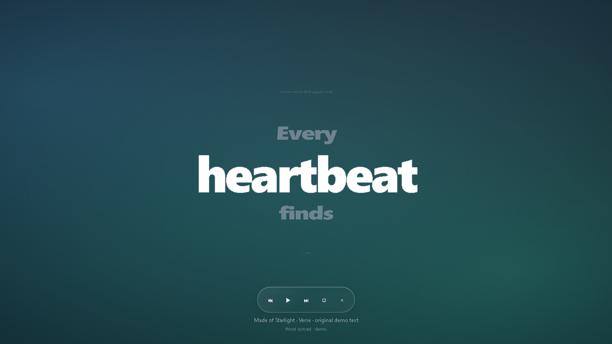
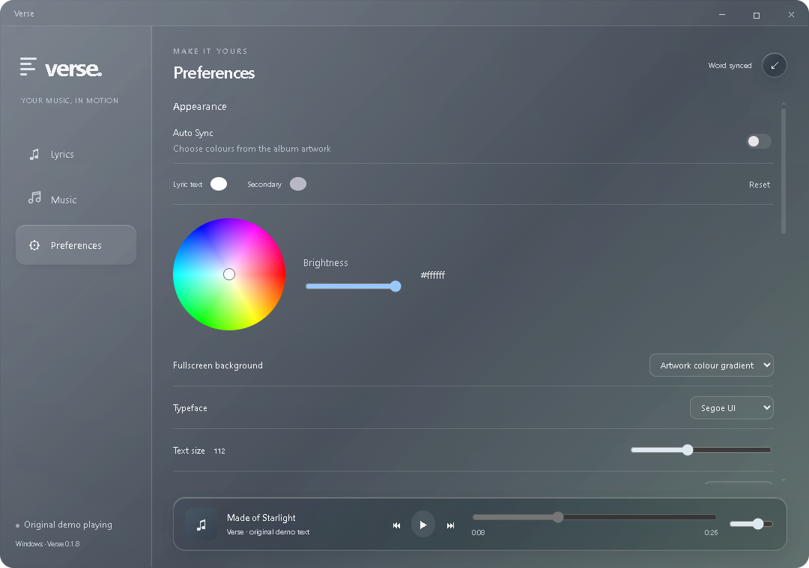

<div align="center">

# Verse

### Your music. In motion.

A Windows music player and animated lyrics companion, wrapped in smoky glass.


[Features](#made-for-listening) · [Run locally](#run-locally) · [Build](#build-for-windows) · [How it works](#under-the-glass)

</div>



**Big words. Quiet controls. A background that moves with the mood.**

Verse combines native music playback, word-by-word lyric animation, a transparent desktop overlay, and an immersive fullscreen view. It is an independent project inspired by Verci, built for Windows.

> **Source-only repository.** Executables, installers, packaged builds, dependencies, local profiles, caches, and test logs are intentionally excluded. Build the app locally using the instructions below.

## Made for listening

| Feature | What you get |
| --- | --- |
| **Music, built in** | Public song search, native audio playback, album artwork, radio recommendations, and an Up next queue. |
| **A personal listening shelf** | Local history and liked songs, with up to 40 tracks in each collection. |
| **Lyrics in motion** | Bold native text, individual-word pop animations, and four display styles: Ship, Fisheye, Fisheye Visual, and Visual. |
| **Two ways to disappear into a song** | A transparent desktop overlay or fullscreen lyrics with flowing artwork-derived gradients. |
| **Smoky glass** | A translucent window, restrained white reflections, smooth page transitions, and gentle ambient motion. |
| **Your typography** | Live text sizing, eight fonts, four weights, text finishes, a colour wheel, and timing adjustment. |
| **Controls where you need them** | Play/pause, previous/next, seek, volume, shuffle, and repeat on the main screen; fullscreen controls on hover or keyboard focus. |
| **Windows media integration** | Follow another player's Windows media session when it exposes useful song metadata and playback timing. |
| **Motion on your terms** | Reduced Motion and optional Windows motion-preference support. |

## Run locally

Requires **Windows 10/11 x64**, **Node.js 22+ with npm**, and the **.NET 8 SDK**.

```powershell
git clone https://github.com/smithcooks/Verse.git
cd Verse
npm ci
npm run bridge
npm start
```

Want to preview the lyrics without connecting a music player?

```powershell
npm run demo
```

Open **Music** to search or choose a recommendation. Use **+** to queue tracks, **Like** to save a song, and **Show lyrics** to enter the selected lyric mode. Closing the main window keeps the app in the tray; choose **Quit Verse** there to exit completely.

| Shortcut | Action |
| --- | --- |
| `Ctrl + Alt + L` | Show or hide lyrics |
| `Ctrl + Alt + ,` | Open the main window |
| `Esc` | Hide fullscreen lyrics |

Drag the glass title bar to move the window. Its **Expand/Restore** button fills the display; native edge resizing is disabled for reliable transparent-window behavior. Glass reflections and blur apply to app content, not the desktop underneath it.

## Make it yours



Choose a typeface, drag the text-size slider, pick a colour from the wheel, or let album artwork inform the palette. Fullscreen defaults to a slow, flowing gradient; artwork and plain backgrounds are also available. **Reduced Motion** stops the background layers and UI animations.

A negative timing offset highlights lyrics later, which can help with Bluetooth delay.

## Under the glass

```text
src/       Electron app, native player, lyric timing, and UI
bridge/    .NET Windows media-session helper
scripts/   JavaScript syntax checks
tests/    Parser, timing, settings, player, and colour tests
replica/   Reference research, architecture, and implementation notes
tasks/     Original build plan and verification checklist
docs/      Original demo screenshots
```

- **Playback:** native HTML audio with an unofficial `youtubei.js` InnerTube adapter. Public search needs no API key or account; the app does not load the YouTube website or read account cookies.
- **Lyrics:** LRCLIB lookup or imported timed `.lrc` files. Enhanced LRC word timestamps drive exact highlighting; line timestamps use **estimated** word pacing. Splitting plain text cannot recover real singing timestamps.
- **Rendering:** at most five native word nodes, transform/opacity motion, 30 Hz word selection while playing, and slower scheduling when idle or hidden. Artwork is downsampled and blurred once; streaming uses bounded 64 KB upstream buffers.
- **Privacy:** local settings and lyric caches live in Electron's Verse user-data directory. History and liked-song metadata stay in local browser storage; queues are session-only. No app accounts, analytics, or application backend.

Search and recommendations contact YouTube Music. Audio and artwork come from YouTube/Google. Lyric lookup sends song title, artist, album, and duration to LRCLIB. Recommendations use the public radio queue seeded by recent local listening, rather than your signed-in account history.

## Build for Windows

```powershell
npm run check
npm test
npm run build    # Unpacked Windows app in dist/win-unpacked/
npm run package  # Portable Windows executable in dist/
```

The media helper's .NET runtime is bundled during packaging, so the packaged app needs no separate .NET runtime installation. The output is unsigned. Build files remain local and are ignored by Git.

For an interactive desktop smoke test after building the bridge:

```powershell
npx electron . --smoke
# Optional: checks real music playback, artwork, radio, and local history.
npx electron . --smoke --music-smoke
```

Smoke tests open app windows, use an isolated local test profile, and write captures/logs to the ignored `artifacts/` folder. The optional music test makes live network requests and briefly plays audio.

## Beta notes

Unit tests and desktop checks cover lyric parsing/timing, settings validation, word rendering, live sizing, window transparency, gradient motion, Reduced Motion, native playback, seeking, recommendations, queue advance, local history/likes, and shutdown.

- The public music provider is unofficial. YouTube changes or regional restrictions can break availability; universal ad-free playback is not guaranteed.
- Signed-in libraries, private playlists, and live streams are outside this version.
- External players must expose a useful Windows media session. Support for every player is not claimed.
- Exact word timing depends on the available lyric data. Enhanced LRC can provide it; ordinary line-timed lyrics cannot.
- The app runs while Windows is unlocked. It does not replace the secure Windows lock screen.
- Long-session CPU/GPU stability and broader multi-monitor/sleep-transition testing remain open. Electron is a substantial runtime; this is not a claim of minimal whole-app memory usage.
- The visual styles are independent approximations, not a pixel-identical reproduction of Verci or its Metal shaders.

## Contributing

Keep changes focused, explain the behavior you changed, and run `npm run check` and `npm test`. For UI changes, include a screenshot and verify Reduced Motion. For playback changes, test pause, seeking, and background playback.

Found a bug? [Open an issue](https://github.com/smithcooks/Verse/issues) with your Windows version, reproduction steps, and whether it happens with the original demo or a real track. Remove private information from logs before sharing them.

---

Built by [smithcooks](https://github.com/smithcooks). Independent of Verci, YouTube, Google, and Apple. Third-party services and dependencies belong to their respective owners.

